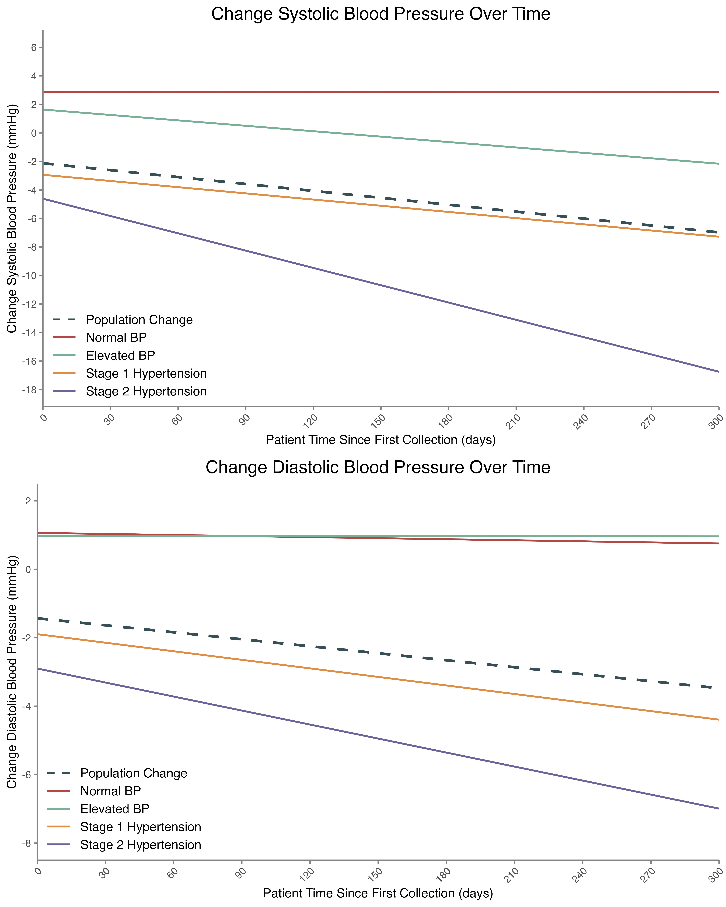

# Hypertension Virtual Care | Michigan Medicine

**Evaluating blood pressure trends in a text-message–based remote monitoring program using R and longitudinal statistical modeling.**

**[Read the full research manuscript (PDF)](CCAH_Hypertension_Submission.pdf)** · [View the analysis code](analysis.R) · [View data preparation](wrangling.R)

## Overview

This project evaluates a hypertension telemonitoring pilot at Michigan Medicine. Participants received weekly text or email messages from an automated *virtual companion*, which collected blood pressure readings and symptoms, provided educational content, and routed qualifying alerts to a nursing team for follow-up.

The analysis investigates how systolic and diastolic blood pressure changed over time among participants recording readings, both overall and by baseline blood pressure classification. The study period was **April 2022–February 2023**.

## Key findings

| Population | Monthly systolic BP change | Monthly diastolic BP change |
| --- | ---: | ---: |
| All participants with recorded readings | −0.49 mmHg | −0.20 mmHg |
| Participants classified with stage 2 hypertension at baseline | **−1.21 mmHg** | **−0.41 mmHg** |

All four estimated monthly trends above were reported as statistically significant (**p < 0.001**) in the accompanying manuscript.

### Marginal Effects of Blood Pressure Classification

<p align="center">
  
</p>

*Figure 1. Estimated monthly changes in systolic and diastolic
blood pressure by baseline classification, compared with
overall population trends.*

- **665** patients were enrolled and sent activation invitations.
- **308** (46%) activated the virtual companion.
- **161** (52% of activated patients) recorded at least one blood pressure measurement.
- The greatest modeled reductions were observed among participants classified with stage 2 hypertension at their first recorded reading.

These findings describe **observed within-participant trends**. As an observational pilot without a randomized control group, the analysis does not establish that the program itself caused the reductions. Self-reported measurements and enrollment/engagement patterns are additional limitations.

## Methods

The analysis used **R** to prepare longitudinal patient blood pressure data and estimate changes relative to each participant's initial reading.

1. **Data preparation:** Clean patient and questionnaire-response exports, combine systolic/diastolic readings, calculate time since the first measurement, and assign baseline BP classifications.
2. **Overall trend model:** Fit separate linear mixed-effects models for systolic and diastolic BP changes over time, with patient-level random intercepts.
3. **Classification-specific models:** Add baseline BP classification and its interaction with time to examine whether longitudinal trends differ by initial BP category.
4. **Sensitivity analysis:** In the manuscript, assess additional predictors including age, race, and the hour of measurement using a likelihood-ratio comparison.

The analysis estimates associations over time; the reported coefficients are **not** randomized treatment effects.

## Repository structure

```text
.
├── CCAH_Hypertension_Submission.pdf   # Research manuscript
├── wrangling.R                        # Data import, cleaning, and feature construction
├── analysis.R                         # Mixed-effects models and visualization
├── journal-metrics.R                  # Supplementary analysis code
├── figs/                              # Analysis figure assets
└── .gitignore
```

## Technology

- **Language:** R
- **Data manipulation:** `tidyverse`, `readxl`
- **Statistical modeling:** `lme4`, `lmerTest`
- **Visualization and reporting:** `ggplot2` (via `tidyverse`), `sjPlot`, `ggsci`, `gridExtra`

## Reproducibility and data access

The scripts document the original analysis workflow. The data preparation code refers to patient-level spreadsheet exports in a local `data/` directory; those source data are **not included in this public repository**. Consequently, the analyses cannot be reproduced end-to-end from this repository alone without appropriately authorized access to the underlying data and any required local setup.

Do not upload identifiable patient data or protected health information to this repository.

## Research manuscript

**[Open the full manuscript — CCAH Hypertension Submission (PDF)](CCAH_Hypertension_Submission.pdf)**

The manuscript includes the intervention design, eligibility criteria, statistical models, findings, limitations, and references. It is presented here as a research manuscript; no publication or peer-review status is asserted.

## Project context

**Institution:** Michigan Medicine  
**Focus:** Hypertension, remote patient monitoring, digital health, longitudinal analysis
